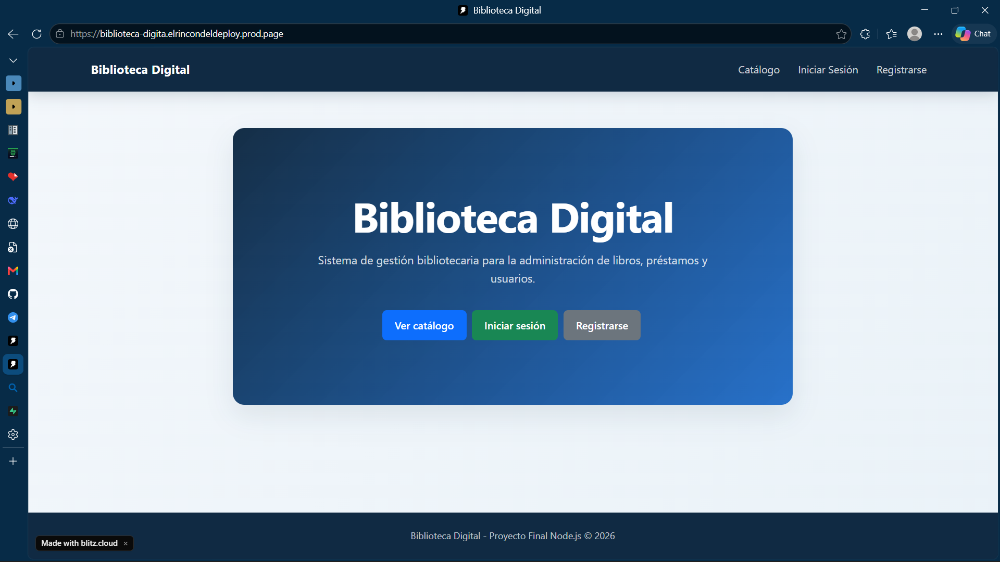
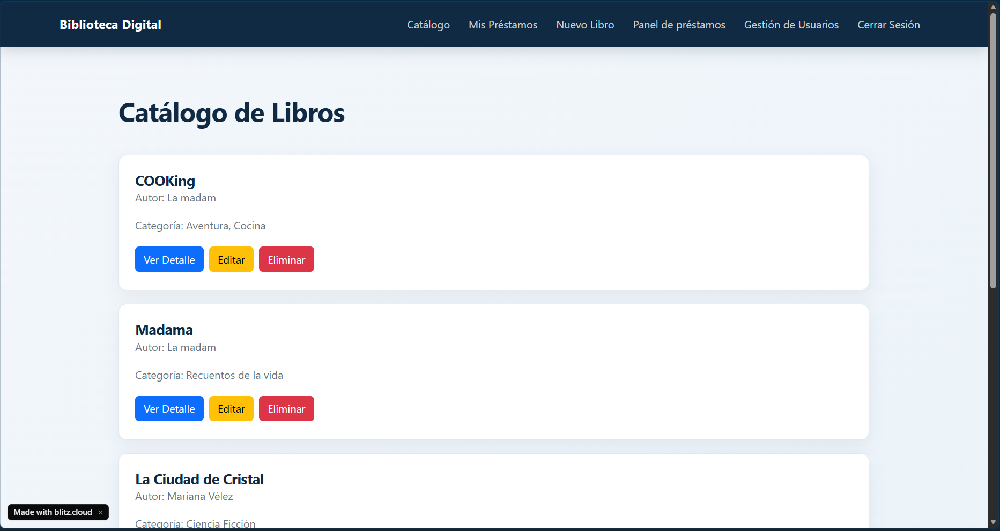
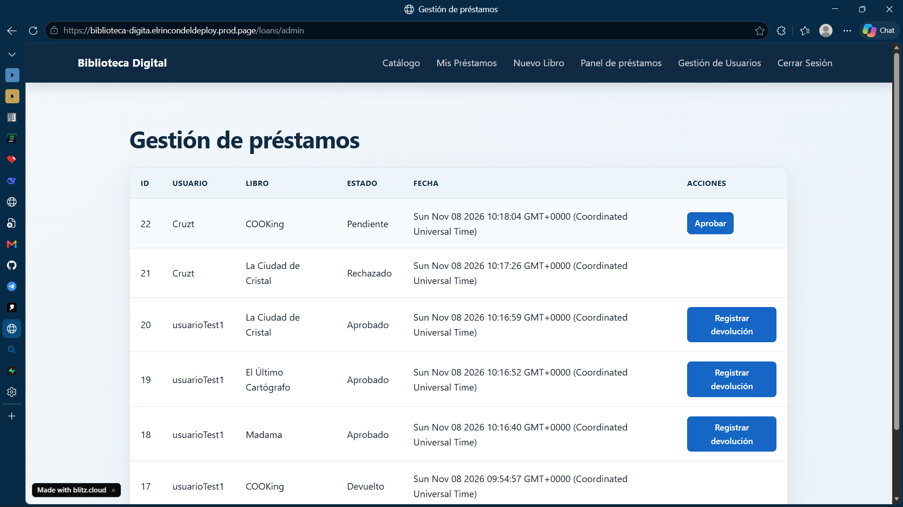
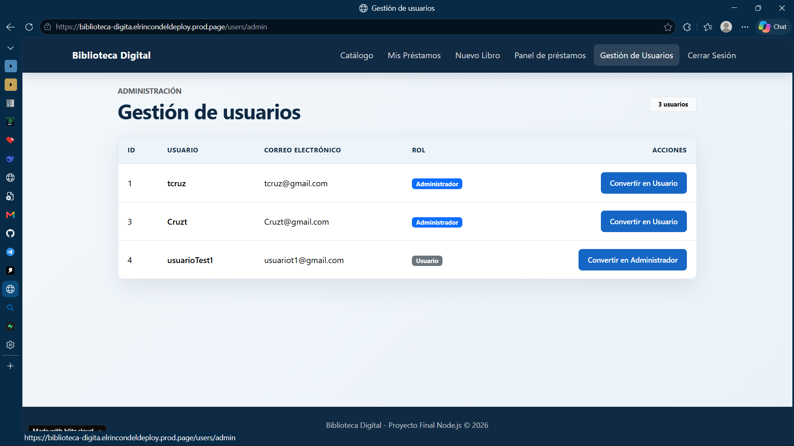

# Biblioteca Digital

Aplicación web full-stack desarrollada con Node.js, Express, PostgreSQL y EJS para la gestión de una biblioteca digital.

## Descripción

Biblioteca Digital es un sistema web que permite administrar libros, usuarios y préstamos bibliotecarios mediante una interfaz web intuitiva y segura.

La aplicación implementa autenticación mediante JSON Web Tokens (JWT), control de acceso por roles y una arquitectura MVC completa.

---

## Funcionalidades

### Usuarios

- Registro de usuarios.
- Inicio de sesión.
- Cierre de sesión.
- Contraseñas protegidas con bcrypt.
- Autenticación mediante JWT.

### Gestión de Libros

- Crear libros.
- Editar libros.
- Eliminar libros.
- Consultar catálogo.
- Ver detalles de libros.
- Control de disponibilidad.

### Gestión de Préstamos

- Solicitar préstamos.
- Ver préstamos personales.
- Aprobar préstamos.
- Registrar devoluciones.
- Evitar préstamos duplicados.

### Gestión de Usuarios

- Visualizar usuarios registrados.
- Asignar rol Administrador.
- Asignar rol Usuario.
- Protección para evitar modificar el propio rol.

---

## Roles

### Usuario

- Consultar catálogo.
- Solicitar préstamos.
- Ver préstamos propios.

### Administrador

- Gestionar libros.
- Gestionar préstamos.
- Gestionar usuarios.
- Aprobar devoluciones.

---

## Tecnologías utilizadas

### Backend

- Node.js
- Express.js

### Base de Datos

- PostgreSQL
- Supabase

### Frontend

- EJS
- Bootstrap 5
- CSS personalizado

### Seguridad

- JWT
- bcrypt
- cookie-parser

### Arquitectura

- MVC (Model View Controller)

---

## Capturas de pantalla

### Página principal



### Catálogo de libros



### Gestión de préstamos



### Gestión de usuarios



---

## Enlace en Producción

Tenemos un despliegue funcional de la aplicación:

URL:https://biblioteca-digita.elrincondeldeploy.prod.page

---

## Instalación Local

### 1. Clonar el repositorio

```bash
git clone URL_DEL_REPOSITORIO
```

### 2. Entrar al proyecto

```bash
cd proyecto-final
```

### 3. Instalar dependencias

```bash
npm install
```

### 4. Configurar variables de entorno

Crear un archivo `.env`:

```env
DATABASE_URL=tu_cadena_de_conexion
JWT_SECRET=tu_clave_secreta
NODE_ENV=development
```

### 5. Ejecutar la aplicación

```bash
npm start
```

La aplicación estará disponible en:

```text
http://localhost:3000
```

---

## Autor

**Thiago Herrera De La Cruz**

Proyecto Final de la asignatura Optativa Node.js.